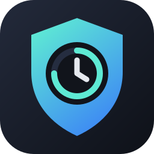
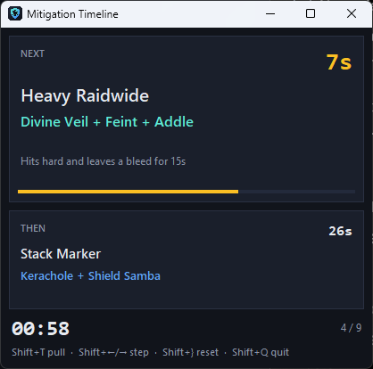
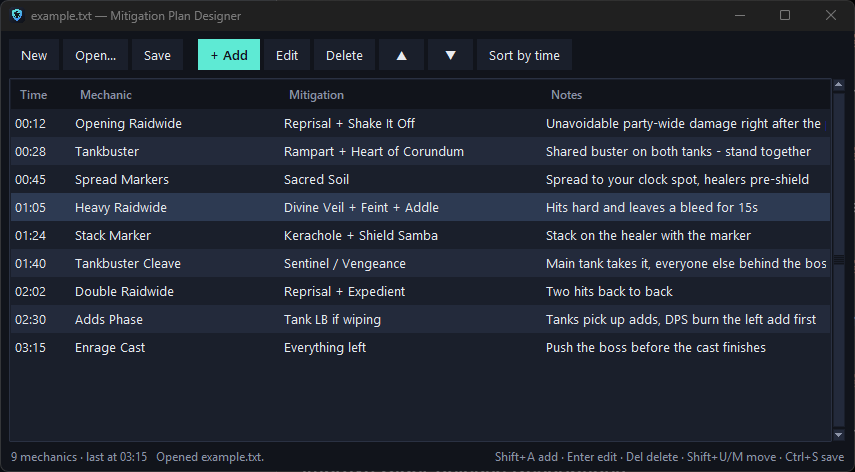

<p align="center">
  
</p>

<h1 align="center">Mitigation Timeline</h1>

<p align="center">
  An always-on-top FFXIV overlay that counts down to each raid mechanic<br>
  and tells you which mitigation to press.
</p>

<p align="center">
  <a href="https://github.com/KonyAHS/Mitigation-Timeline/releases/latest"></a>
  <a href="https://github.com/KonyAHS/Mitigation-Timeline/actions/workflows/ci.yml"></a>
</p>

<p align="center">
  
</p>

Write your mitigation plan once, press **Shift+T** on the pull, and the overlay walks you
through the fight: the next mechanic, how long until it hits, what to press, and what comes after.

## Download

1. Grab `MitigationTimeline-<version>-windows.zip` from the
   [latest release](https://github.com/KonyAHS/Mitigation-Timeline/releases/latest).
2. Unzip it anywhere and run **`MitigationOverlay.exe`**. No Python needed.
3. Make your own plans with **`PlanDesigner.exe`** and save them in the `plans` folder.

> Windows SmartScreen may warn about an unsigned app the first time: click *More info → Run anyway*.

## Hotkeys

The hotkeys are global, so they work while the game has focus.

| Key            | Action                                                         |
| -------------- | -------------------------------------------------------------- |
| `Shift+T`      | Start the timer (press it on the pull)                         |
| `Shift+→`      | The next mechanic is happening *now*: re-sync the clock to it  |
| `Shift+←`      | Undo one step                                                  |
| `Shift+}`      | Reset and go back to plan selection                            |
| `Shift+Q`      | Quit                                                           |

Use `Shift+→` when the boss is early or late. The countdown turns yellow at 10 seconds and red at 5.

## Making a plan



The **Plan Designer** edits plans like a spreadsheet. Double-click or press Enter to edit a row,
`Shift+A` adds one, `Del` deletes, `Shift+U`/`Shift+M` move it, and `Ctrl+S` saves.

Plans are plain text files, so you can also write them by hand:

```text
Mechanic: Tankbuster
Notes: Shared buster on both tanks - stand together
Mitigation: Rampart + Heart of Corundum
Time: 00:28

Mechanic: Heavy Raidwide
Notes: Hits hard and leaves a bleed for 15s
Mitigation: Divine Veil + Feint + Addle
Time: 01:05
```

`Time` counts from the pull (`MM:SS`) and is required. `Notes` and `Mitigation` are optional.
Lines starting with `#` are comments. See [`plans/example.txt`](plans/example.txt).

The overlay lists every plan in the `plans` folder next to the app. Use *Open…* to load one from
anywhere else.

## Overlay options

```text
MitigationOverlay.exe [plan.txt] [--opacity 0.85] [--no-topmost] [--no-global-hotkeys]
```

`--no-global-hotkeys` makes the hotkeys work only while the overlay window is focused.

## Running from source

Requires [uv](https://docs.astral.sh/uv/) (or Python 3.10+ with `pip install -e .`).

```sh
uv run mitigation-overlay     # the overlay
uv run mitigation-designer    # the plan designer
uv run pytest                 # tests
```

<details>
<summary>Maintainer notes</summary>

- **Release:** bump `__version__` in `src/mitigation_timeline/__init__.py`, update
  `.github/release-notes.md`, then push a matching tag (`git tag v1.0.1 && git push --tags`).
  GitHub Actions builds the exes and publishes the release.
- **Local build:** `uv run --group build python scripts/build.py` writes the zip to `dist/`.
- **Icon:** edit `assets/icon.svg`, then
  `uv run --no-project --with resvg-py --with pillow python scripts/render_icon.py`.
- **Screenshots:** `uv run --with pillow python scripts/screenshots.py`.

</details>
